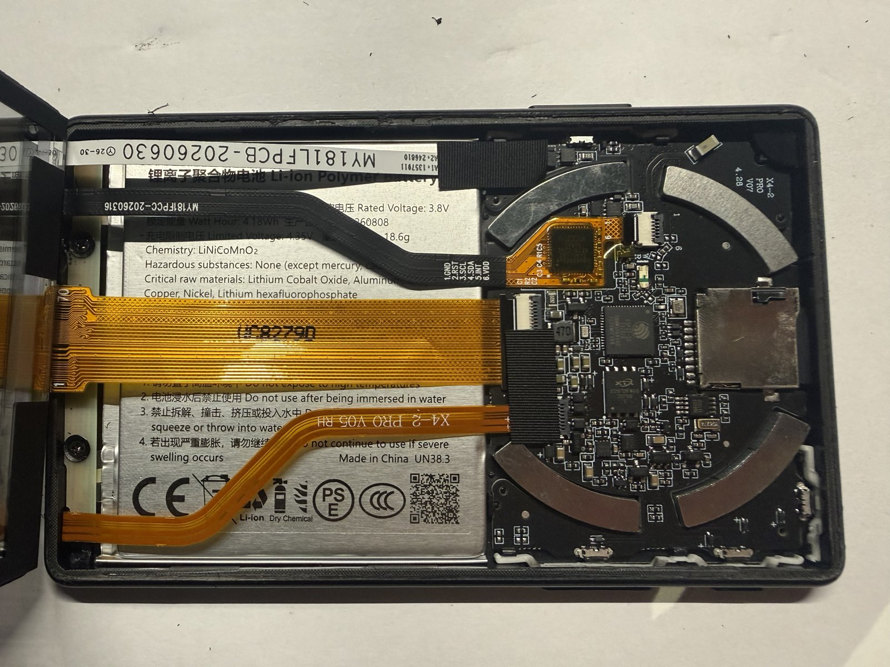

# USB-locked X4 Pro

Some X4 Pro units (Chinese retail, `device_type=ESP32S3_X4_TL_SSD1677`) ship
with flashing over USB-C off: esptool does not connect, eFuses cannot be read
from the PC. What our locked unit has burned: below.

## Our locked unit (2026-10-29)

Bought locked (AliExpress, China firmware), CrossPoint (`arduino-lib-builder
ee57070`, IDF 5.5.5) put on by the unlocker, then this firmware from
CrossPoint's SD update (0.7.0, it confirmed its trial boot). Read on our
console (`hwinfo`, `efuse`, `nvs ls`):

| Hardware | |
|---|---|
| chip | ESP32-S3 rev v0.2, 2 cores; MAC `b8:1f:3f:cf:fb:0c` (BT `…:0e`) |
| flash | 16 MB XTX (JEDEC `0b4018`), not the Puya of our open unit |
| PSRAM | 8 MB, AP 3.3 V, 85 °C (eFuse) |
| panel, touch | UC8279 (stock `screenType` 2), GT911 (firmware `0x1060`, 480 x 800) |
| clock, battery | BM8563 at `0x51`; CW2017 at `0x63`, charger STAT on GPIO21 |
| LED | none |
| bootloader | IDF v6.0.1, Jul 14 2026 (the open unit's: Sep 15 2026) |
| factory serial (`BLOCK3`) | `X4CB02CN26081005511` (`CN`; our open unit `X4CB02EN…`) |

| Stock settings (NVS) | |
|---|---|
| `hw_calib` | `screenType` 2, `region` 1 (the open unit: 2) |
| `user_config` | `timeZone` 8 (UTC+8; the open unit: -5), `language` 1, `sysFontMid` "misans-demibold" |
| Xteink cloud | `cloud_dev_id` "13630220_B8_1F_3F_CF_FB_0C" (`<id>_<MAC>`), `cloud_bind_st` 2, `activate` 0 |
| stock Wi-Fi | `sta_ssid` "XT", `sta_pwd` 8 chars, `wifi_creds` 110 chars, in plain text |

| Firmware now | |
|---|---|
| `app0`, `app1` | ours (0.7.0-5 running, 0.7.0 beside it); CrossPoint no longer in the flash |
| `/sdcard/firmware.bin` | CrossPoint 1.6.5 (`crosspoint-1.6.5-x4pro.bin`): the way back |
| `config.json` | `usb.mode` serial (the console on `303a:4001`) |

| eFuse | |
|---|---|
| `DIS_USB_SERIAL_JTAG` | **1**: the Serial/JTAG controller off (no ROM flashing, no `jtag` console) |
| `DIS_USB_SERIAL_JTAG_DOWNLOAD_MODE` | **1** |
| `DIS_USB_OTG_DOWNLOAD_MODE` | **1**: no ROM flashing over USB-OTG either |
| `DIS_USB_OTG` | 0: TinyUSB works (`usb mode serial`: `303a:4001`, the console) |
| `DIS_DOWNLOAD_MODE`, `DIS_FORCE_DOWNLOAD` | 0: the ROM's UART download is still there |
| `DIS_USB_JTAG`, `DIS_PAD_JTAG`, `SOFT_DIS_JTAG` | 0 |
| secure boot, flash encryption (`SPI_BOOT_CRYPT_CNT`) | off, 0; key blocks unused |
| `RD_DIS`, `WR_DIS` | 0: nothing write-protected |
| blk version | v1.4 |
| key blocks `KEY0`..`KEY5`, `SYS_DATA_PART2` | all zero, `KEY_PURPOSE_*` 0: no key burned |
| the rest of `BLOCK0` | as on our open unit: `VDD_SPI_FORCE`/`TIEH`/`XPD` 1 (flash at 3.3 V), `PIN_POWER_SELECTION` 1 |

So the lock is only the USB ROM download; everything else is open:

- The console: Settings > Devices > USB port = serial (saved in
  `config.json`), then the CDC port. `jtag` mode shows nothing on this unit.
- Recovery without USB: the ROM's UART download (UART0: GPIO43 TX / GPIO44
  RX on a USB-UART adapter, the case open; GPIO0 is the Left button: held at
  reset) or an SPI programmer on the flash: both work, no flash encryption.
- CrossPoint is gone from the flash once our next update takes its slot;
  its release `.bin` (`crosspoint-<v>-x4pro.bin`: board tag `x4pro`, the
  descriptor says `arduino-lib-builder`, not its version) as
  `/sdcard/firmware.bin`, then About > Firmware from SD (or `ota sd force
  confirm`) goes back. `utils/firmware.py put` replaces that file: put
  CrossPoint back after our update.
- Nothing is write-protected (`WR_DIS` 0): a later stock firmware or stock
  OTA could burn more (download mode, secure boot, flash encryption). Do not
  put the stock firmware back on a locked unit.

What else the stock firmware left (`nvs ls`, `spiffs ls`; secrets by length
only):

- NVS `user_config` (21 keys, the table above has the telling ones): also
  `sysFontSm` / `sysFontBd` (SHA-256 of font files), `lightBri` 100,
  `wallpMode` 3, `otaPromptDay` 2026281; `phy` calibration. Ours beside
  them: `vault` / `fido` (`store_ver`), `nimble_bond`. `nvs rm user_config
  <key>` drops one (the stock Wi-Fi: `sta_ssid`, `sta_pwd`, `wifi_creds`).
- SPIFFS: the stock `/README.md` in the root (38 bytes, UTF-8): "spiffs
  分区默认文件夹 根目录" ("spiffs partition default folder, root
  directory"), a placeholder so the partition is not empty. The same bytes on
  both units, CN and EN (the open unit's backup,
  `originalfw/parts/spiffs_0xfd0000.bin`): not by region. Ours beside it:
  `seed.txt`, `config.json`. Nothing reads it; `spiffs rm README.md` is
  harmless.

## What the lock is

- Stock OTA takes only an `encrypted_v1` `.xota` package (`XOTA`, IV,
  AES-128-CTR metadata + body, SHA-256 of the body). This is the transport
  encryption, not eFuse flash encryption. The Xteink Unlocker
  ([unlocker-tool](https://github.com/crosspoint-reader/crosspoint-tools/blob/master/unlocker-tool/README.md))
  wraps CrossPoint into it and serves it from a spoofed update server.
- Secure boot and flash encryption: off on our locked unit (above). Flash
  encryption would not matter for OTA anyway: `esp_partition_write` /
  `esp_ota_write` encrypt themselves on an encrypted chip.

## Stock OTA (X4 Pro)

From [unlocker-tool: X4 Pro OTA system](https://github.com/crosspoint-reader/crosspoint-tools/tree/master/unlocker-tool#x4-pro-ota-system)
and [X4Pro-002, section 7](https://github.com/jglerner/XTEink-Lab-X4-Pro/blob/main/docs/X4Pro-002%20-%20CrossPoint%20OTA%20Unlock%20Routine.md):

- Check: plain HTTP `GET http://api-prod.xteink.cc/api/v1/check-update`
  (`.cn` mirror), query `current_version`, `device_type`, `device_id`, `lng`,
  `ota_type`. The query's `device_type` carries the panel
  (`ESP32S3_X4_TL_SSD1677`), the header's is bare (`ESP32S3_X4_TL`); the bare
  one in the query: "No update available".
- Answer: `version`, `download_url` (Alibaba OSS, `firmware/encrypted/`),
  `ota_format: "encrypted_v1"`, `plain_size`, `plain_sha256`. Only `.xota`,
  never a plain image; `ota_type` 0 and 1: the same image under different AES
  keys (in `crates/unlocker-core/src/xota.rs`).
- `.xota`: metadata bytes 0-3 the body length (LE u32), 4-35 its SHA-256;
  the stock `60 a5 67 00` is no magic, it is 6,792,544, the stock image size.
- NTP before the check (`pool.ntp.org`, `time.google.com`): without an
  answer the device waits forever; the unlocker runs an SNTP responder.
- XTOS V7.6.10 asks AliDNS `223.5.5.5` directly, past the hosts file.
- A plain flash of a slot without `VALID` in otadata boots once, then rolls
  back ("had to flash twice"); the CRC covers only the sequence number.
- The unlock depends on the stock check-update behaviour: a later stock
  update may close it.

## USB on a locked unit

From [X4Pro-001](https://github.com/jglerner/XTEink-Lab-X4-Pro/blob/main/docs/X4Pro-001%20-%20Initial%20USB%20Connection%20Investigation.md)
(an AliExpress unit with China firmware, then CrossPoint):

- CrossPoint running normally: no enumeration (`error -71`, nothing in
  `lsusb`). Whether the Serial/JTAG ever shows is untested; esptool and the
  web flasher never connected.
- CrossPoint's USB Drive mode (TinyUSB MSC on the OTG controller):
  `303a:1001 CrossPoint CrossPoint_X4_Pro`. So `DIS_USB_OTG` is not burned
  there and this firmware's `serial` / `serial+fido` modes should work.
- The unlocker makes SD flashing possible, not USB flashing.

## Installing this firmware

From CrossPoint: `build/esp32-authenticator.bin` on the SD card, Settings >
System > SD Card Firmware Update. Without taking the card out:
[X4ProAirFlash](https://github.com/jglerner/XTEink-Lab-X4-Pro/blob/main/docs/X4Pro-003%20-%20X4ProAirFlash.md)
(`POST http://<device>/upload?path=/` to CrossPoint's web server, saved as
`/update.bin`), then the same menu; installing always takes a tap on the
device. The SD path compares no versions. Its checks
(`../crosspoint-reader/src/network/FirmwareFlasher.cpp`) all pass:

| Check | This image |
|---|---|
| chip id | ESP32-S3 |
| header, segments, XOR checksum, SHA-256 trailer | as `idf.py build` writes them |
| size <= slot (0x7E0000) | ~2.5 MB |
| board tag `CROSSPOINT-BOARD-V1:<name>;` | `x4pro` (`X4Pro::crosspoint_tag`): CrossPoint on another board refuses it |

The partition table stays stock and matches `partitions.csv`. The image goes
to the other slot with otadata state `NEW` (`OtaBootSwitch.cpp`), so it boots
on trial: confirmed 30 s after `ota::BootDone()` (the end of `app_main`); a
reset or panic before that rolls back to CrossPoint, and so does a boot not
done in 2 min (`ota::Boot` restarts it: `ShouldGiveUp`).

First boot on CrossPoint's flash: its NVS is kept (erased only when full or
of another version); CrossPoint leaves the stock SPIFFS alone (SPIFFS and
LittleFS off in its `platformio.ini`). No `config.json`: Wi-Fi off, USB
`jtag`.

The PIN pad on a fresh unit (card in): no `vault.bin` yet, so the PIN typed
(twice) makes the store and, in SPIFFS, the seed phrase; Settings open after
it. No card: no stores, no PIN pad.

- SPIFFS not mounted (nothing formats it): no seed phrase, so no store opens
  or can be made; the stores are off and there is no PIN pad (`StorageDir`),
  Settings open. `spiffs format` on the console, then a restart. Only on a
  fresh unit: on one in use it erases the seed phrase, and the stores on the
  card never open again without its 12 words.
- Stuck on the PIN pad anyway (the store cannot be made, the card refused):
  Power held (off), the card out, Power: no stores, no PIN pad; Settings >
  Devices > USB port = serial, then the console (`hwinfo`, `sd`, `spiffs`).
  The card in again and a restart. Without the card at boot About > Firmware
  from SD has nothing to read (the card mounts at boot only).

## After the first boot

- eFuses: `hwinfo.html` on the web site (or `hwinfo` on the console): secure
  boot, flash encryption, `DIS_USB_*`.
- Console: with only the download mode off, the Serial/JTAG console works.
  With the Serial/JTAG off but OTG on (what the unit above looks like):
  Settings > Devices > USB port = serial (CDC-ACM). With `DIS_USB_OTG` the
  TinyUSB modes are refused
  (`ESP_ERR_NOT_SUPPORTED`, the port stays Serial/JTAG) instead of hanging in
  TinyUSB's core reset.
- The next firmware of ours: `/sdcard/firmware.bin` and Settings > About >
  Firmware from SD (held Yes; no Wi-Fi or console needed), the web site
  (upload or the card; Wi-Fi switched on in Settings > Wi-Fi), the console
  (`ota sd confirm`) or Server > Firmware.
- Back to CrossPoint: its `.bin` as `/sdcard/firmware.bin`, then About >
  Firmware from SD ("Install another firmware?", held Yes), `ota sd force
  confirm` or the site with "Install another firmware too" ticked. Without
  that, another project's image is refused (`kWrongProject`); chip, revision,
  size, checksum and SHA-256 are checked either way. CrossPoint (Arduino)
  confirms its own trial boot.

## When a firmware gets stuck

[crosspoint-reader #3917](https://github.com/crosspoint-reader/crosspoint-reader/issues/3917)
(Oct 2026, open): a USB-locked X4 Pro took a broken CrossPoint fork
(CrossPink 8.10) from the SD card; it crashes at random and has no menu to
flash another one. The only way out left is the SPI flash chip.

*An X4 Pro opened (photo from #3917): the board `X4-2 PRO V07`, the panel's
cable `UC8279D`, the ESP32-S3 in the middle with the 8-pin SPI flash (XTX)
beside it, the microSD slot on the right.*

- Why this firmware keeps a way out: a first boot that crashes, hangs or
  resets rolls back (above); once confirmed, About > Firmware from SD needs
  only the card and the screen.
- SPI programmer (`../crosspoint-reader/docs/fix-bricked-xteink.md`: the
  screen glued, a clip on the flash): only with flash encryption off. A full
  dump is exactly 16,777,216 bytes; the web flasher's backup times out, and a
  locked unit cannot be dumped over USB at all.
- Image for it: `originalfw/x4pro_full_16MB.bin` (our unlocked unit, stock
  firmware, checked by `verify-flash`; not in git, see
  [originalfw/README.md](../originalfw/README.md)). It carries our unit's NVS
  (PHY calibration, `screenType`), not the other unit's. #3917 links another
  X4 Pro's full dump (esptool `read-flash 0 0x1000000 --no-stub`).

## Sources

- [XTEink-Lab-X4-Pro](https://github.com/jglerner/XTEink-Lab-X4-Pro): X4 Pro research (USB, the OTA unlock, X4ProAirFlash).
- [unlocker-tool README](https://github.com/crosspoint-reader/crosspoint-tools/blob/master/unlocker-tool/README.md): `.xota`, flash layout, OTA state.
- [crosspoint-reader #1918](https://github.com/crosspoint-reader/crosspoint-reader/issues/1918): OTA on a USB-locked X4.
- [crosspoint-reader #3917](https://github.com/crosspoint-reader/crosspoint-reader/issues/3917): a locked X4 Pro stuck on a broken firmware, SPI recovery.
- [pocketink.io firmware FAQ](https://pocketink.io/firmware/faq/), [CrossPoint](https://pocketink.io/firmware/crosspoint/).
