# ESP32Authenticator: user manual

A password manager and a FIDO2 / U2F security key on the XTEINK X4 Pro.
It types logins, passwords and TOTP codes into a computer or a phone as a
Bluetooth keyboard, and signs in to sites as a Bluetooth FIDO2 key.

Buttons: **Left** and **Right** on the side edges, **Home** (the touch key
under the glass), **Power**, and **Reset** (the small one on the top edge,
on the right).

## PIN

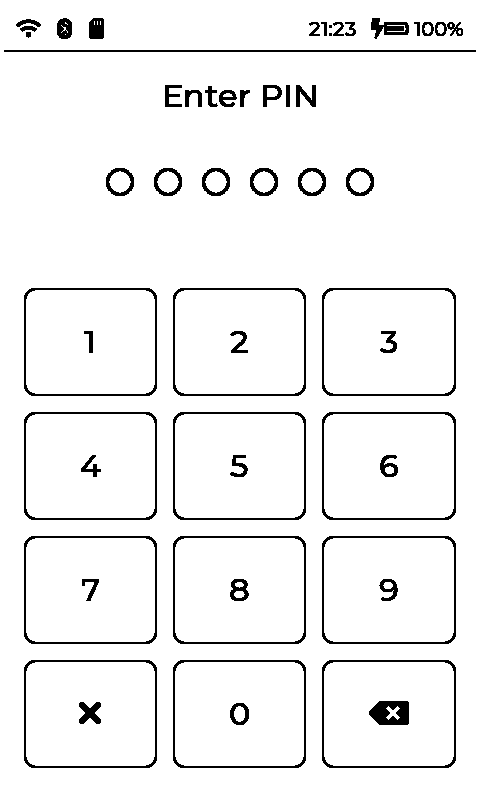

The passwords and the FIDO2 keys are stored encrypted. The **6-digit PIN**
is the key to them: nothing can be read or used until it is typed.

- After a start, a reset or a power-off locked with Power x3, the device
  shows the PIN pad. Type the 6 digits: the PIN is checked when the last
  digit is in. **✕** clears the digits, **⌫** removes the last one.
- First start with an empty card: choose a PIN and type it twice.
- 10 wrong PINs in a row lock the pad for a while (Settings > Security >
  *10 wrong PINs: lock*). A restart does not reset the count.
- After a power-off by the idle timer or Power held, no PIN is needed within
  *PIN after sleep* (Settings > Display & power, 8 hours by default).
- Settings > Security: *Change the PIN*, *PIN complexity* (no repeats,
  runs or common PINs), *Wipe PIN* (a second PIN that, typed on this pad,
  **erases** every password and FIDO2 key), *Lock now*.
- The FIDO2 PIN that sites and the browser ask for is a different one: it is
  set from the computer (e.g. Windows: Settings > Accounts > Passkeys / a
  security key).

 

## Status bar

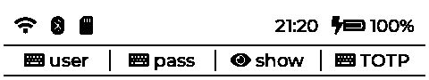

At the top of every screen.

- Left: **Wi-Fi** (`...` connecting, `!` no internet, `AP` the device's own
  access point), **Bluetooth** (`...` no host connected, `pair` the pairing
  window is open), **SD card**. Something that is off is not shown.
- Right: the time (once the clock is set), the battery with its charge
  (a lightning bolt: charging).
- The second line (on the password list only) says what a tap in each
  quarter of a record does: type the user, type the password, show the
  password, type the TOTP code.

## Passwords

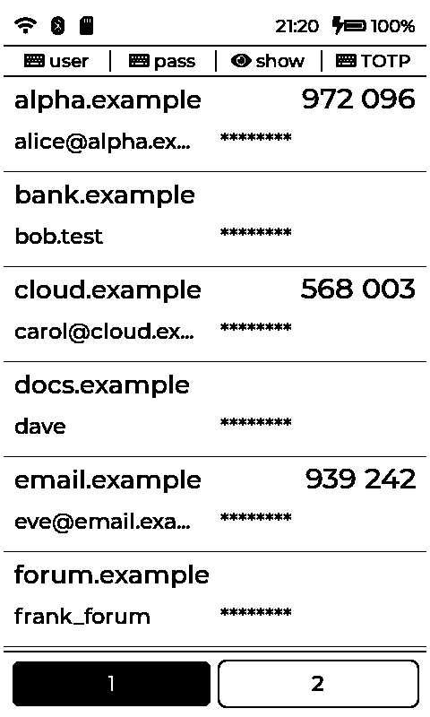

The main screen: the records in your order, 6 a page.

- A record: the site with its TOTP code (when it has one, new every 30 s),
  the user, the password hidden.
- Tap a quarter of the record (see the status bar's second line): **user**,
  **pass**word, **show** the password (20 s; a tap hides it), **TOTP** code.
  Typing needs a connected Bluetooth host (see below); the text is typed
  where the cursor is.
- Pages: the tabs at the bottom, or Left / Right; Home: page 1.
- Records are added, edited, deleted and ordered on the web site (below).
- A swipe **down** from the top opens Settings; a swipe **up** from the
  bottom opens the FIDO2 keys.

 

## Settings

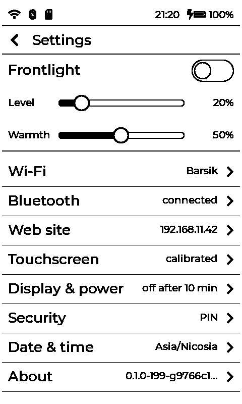

A swipe down from the top quarter of the screen. The back arrow, a swipe up
or Home closes it.

- **Frontlight**: the switch, Level and Warmth.
- A row per page with its summary: Wi-Fi, Bluetooth, Web site, Touchscreen
  (calibration), Display & power, Security, Date & time, About (versions,
  Restart).

 

### Bluetooth

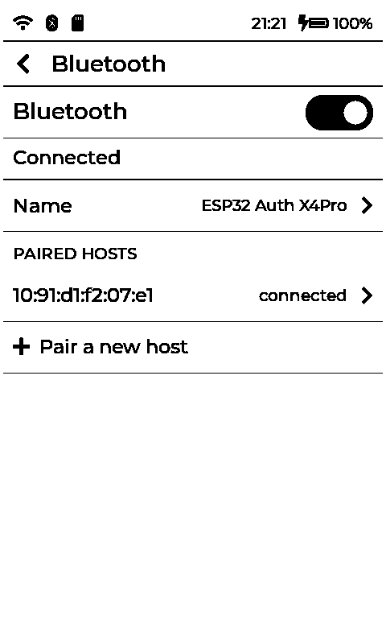

- The switch, the state, the device's name.
- **Paired hosts**: a tap: *Use only this host* / *Let any paired host in*,
  *Forget*.
- **Pair a new host**: opens a 60 s window. On the computer or phone:
  Bluetooth settings, add a device, pick the device's name, then type the
  number the device shows. One pairing gives both the keyboard and the
  FIDO2 key.

 

### Wi-Fi

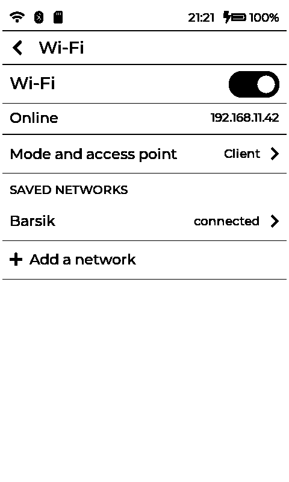

Wi-Fi is needed for the web site and the clock (time sync).

- The switch and the state (the IP address when online).
- **Mode and access point**: client, the device's own access point, or
  both; the access point's name, password and channel; the hostname.
- **Saved networks**: a tap: *Connect* (tried first), *IP address* (DHCP
  or static), *Forget*.
- **Add a network**: a scan; a tap joins it (the password on the screen
  keyboard). *Other...*: a hidden network.

 

### Web site

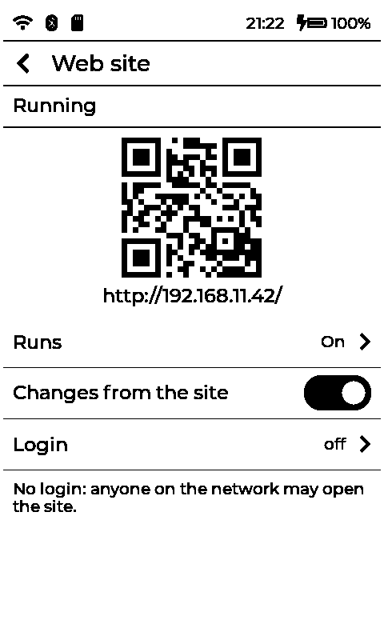

- The address and its QR code: open it on a computer or a phone in the same
  network.
- *Runs*: off / on / only on the device's access point. *Changes from the
  site*: off makes the site read-only. *Login*: a user and a password for
  the site (without it anyone on the network may open it).

The site has the passwords (below), the FIDO2 keys, Wi-Fi and the device
settings. Settings changed there are kept until the device restarts unless
saved.

 

## Passwords on the web site

Open the site, then **Passwords**. A locked device asks for the PIN first.

- Top: **Add a record**, **Sort A to Z**, **Lock**, then **Find** (by site
  or user).
- A record: its number on the device, site / user, then the buttons:
  **⇈** to the top, **↑** up one, **↓** down one, **⇊** to the bottom,
  **×** delete (tap twice).
- Below it: password set or not, when it was changed, the TOTP code, and
  the edit fields. A password or TOTP box left empty keeps the old value.
  Passwords are never sent back to the browser.
- Every change is written to the device at once.

## FIDO2 / U2F keys

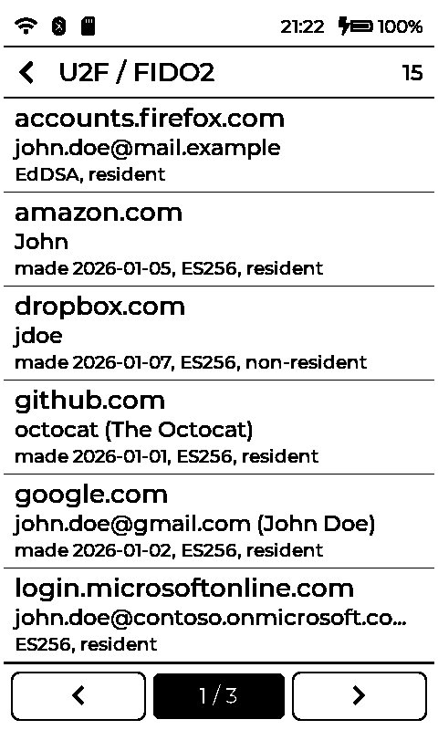

A swipe up from the bottom quarter of the password list (or Settings >
Security > FIDO2 > *Show the keys*).

- The keys by site: the site, the account, when it was made, the
  algorithm, *resident* (a passkey) or not.
- Left / Right or the bar at the bottom flip pages; the number at the top is
  how many keys there are.
- **Delete**: swipe a key to the left, tap the trash can, then hold
  **Yes** for 4 s (*No* or Right cancels).

 

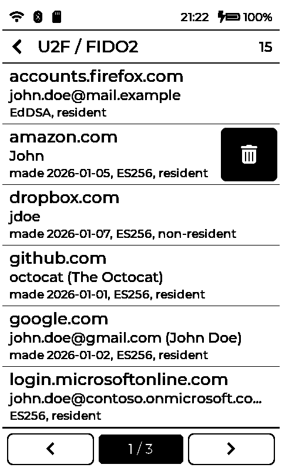
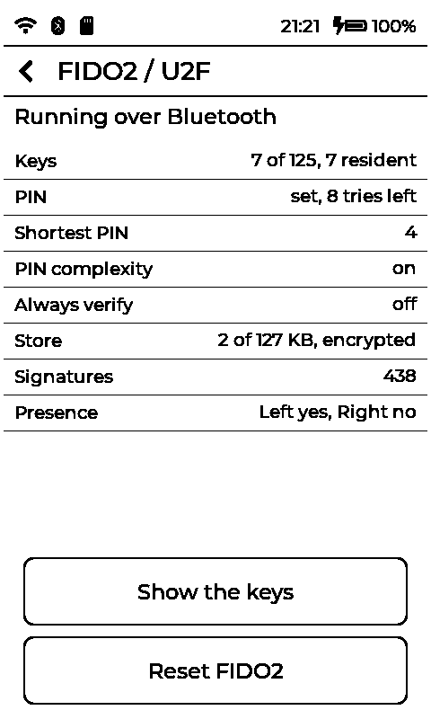

Settings > Security > **FIDO2**: the state, the keys, the FIDO2 PIN and its
tries, *Reset FIDO2* (held 4 s: **every key and the FIDO2 PIN erased**).

### Signing in

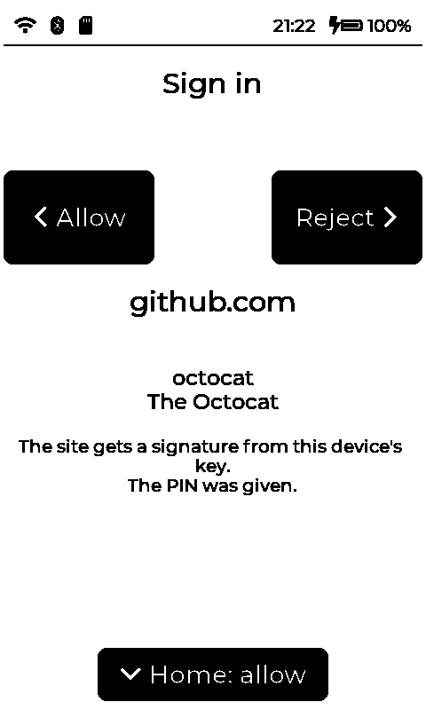

When a site asks for the key, the device shows what is asked (create a key,
sign in, U2F), the site and the account(s).

- **Left** or **Home**: allow. **Right**: reject.
- Nothing pressed: the request times out on the computer.
- FIDO2 works while the screen is locked by the idle timer, but not after a
  restart until the PIN is typed.

 

## Power, frontlight, reset

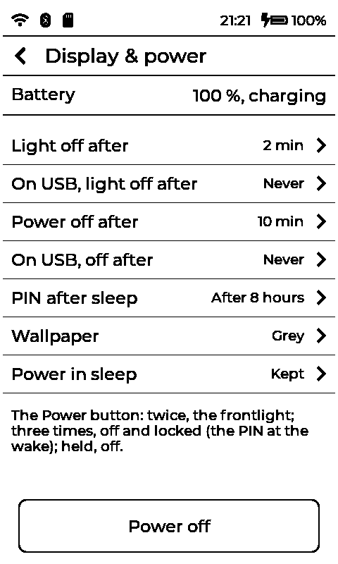

- **Power button**: twice: frontlight on / off; three times: off and
  locked (the PIN at the wake); held: off. Power wakes the device.
- Off, the screen keeps a random picture from the card's `wallpapers`
  folder.
- **Charging**: USB-C; the status bar shows the bolt.
- Settings > **Display & power**: the battery; *Light off after* and *Power
  off after* (and their values on USB power); *PIN after sleep*;
  *Wallpaper* (grey or black & white); *Power in sleep* (*off* saves the
  battery but forgets the PIN); *Power off*.
- **Frontlight**: Settings, at the top (switch, Level, Warmth). It goes off
  after *Light off after* and comes on again at a touch or a button.
- **Reset** (the small button on the top edge, on the right): restarts the
  device, e.g. when it does not answer. Nothing is lost; the PIN is asked
  again.

 

## The SD card

| Path | What |
|---|---|
| `.authenticator/vault.bin` | the passwords (encrypted with the PIN) |
| `.authenticator/fido.bin` | the FIDO2 / U2F keys (encrypted with the PIN) |
| `wallpapers/` | PNG pictures for the power-off screen |
| `Books/`, `Fonts/`, `XTData/`, `XTCache/` | the stock reader firmware's; not used |

- Without a card there are no passwords and no FIDO2 keys.
- Copy `.authenticator` to keep a backup; it is useless without the PIN.
  Do not edit or delete these files while the device is on.
- The device's settings (`config.json`) are in its own flash, not on the
  card.
